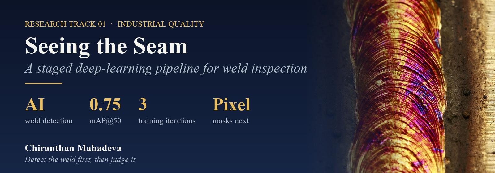
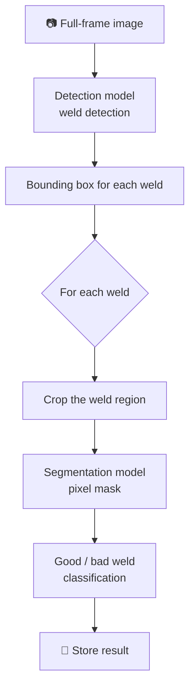
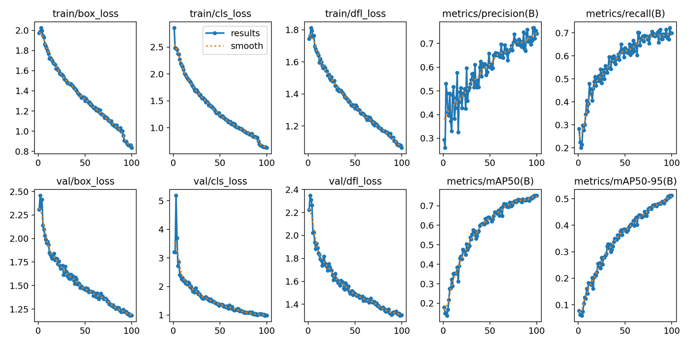
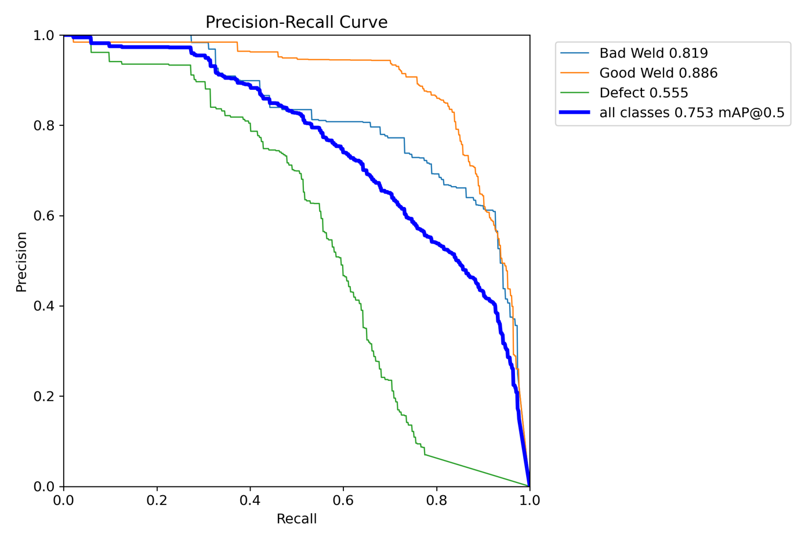
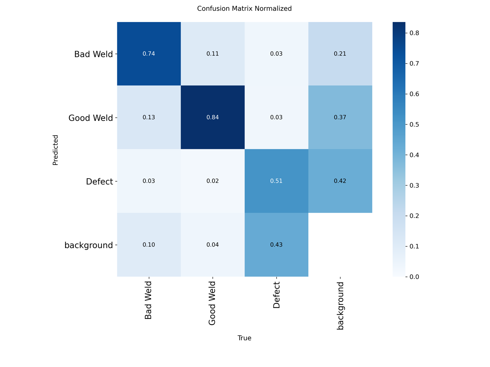
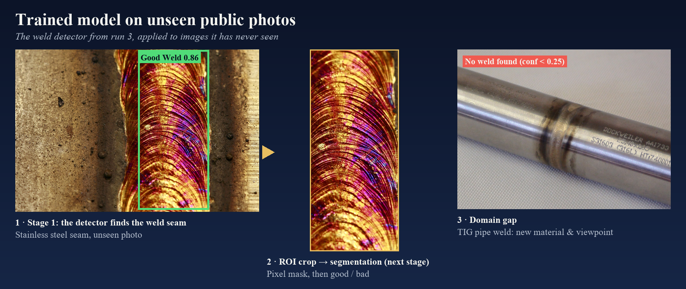

[← All research tracks](../README.md)

## 🔥 The problem

Weld seams decide whether a welded part holds or fails. On a production line they're still often checked **by eye**: slow, tiring and subjective.
A camera sees the whole part in one high-resolution frame, but the welds are **small regions** inside it, and the defects (porosity, spatter, incomplete fusion) are smaller still.

**Research question:** can a staged deep-learning pipeline first **find** each weld and then **judge** it, reliably enough for an industrial line?

## 🧠 The idea: detect first, judge second

Instead of asking one model to do everything on the full frame, the pipeline splits the job:

| Stage | Model | Why |
|---|---|---|
| 1. Find | **Object-detection model** | Fast and robust at locating welds anywhere in a large frame |
| 2. Outline | **Segmentation model** | Pixel-level shape of the seam: width, gaps and holes become measurable |
| 3. Judge | Classifier on the mask | The good/bad decision rests on the seam's geometry, not on raw pixels |

## 🛠️ What I built and tested

**Stage 1: weld detection** (implemented and trained)
- Trained a **compact object-detection model** in Google Colab on a GPU: 100 epochs at 640 px, batch size 16.
- Classes: **Good Weld**, **Bad Weld** and **Defect**.
- **3 training iterations** with identical settings (model, epochs, seed). Only the dataset version changed. Values are from the final epoch:

| Iteration | Precision | Recall | mAP@50 | mAP@50–95 |
|---|:--:|:--:|:--:|:--:|
| Run 1 | 0.73 | 0.69 | 0.72 | 0.49 |
| Run 2 | 0.62 | 0.57 | 0.56 | 0.21 |
| **Run 3 (best)** | **0.74** | **0.70** | **0.75** | **0.51** |

  

  
  

**ROI-guided inference for the production frame**
- On a fixed fixture the welds are always in the same place. So the weld **regions of interest are marked once** on a reference image (OpenCV `selectROIs`) and saved.
- At runtime, the detector runs on **each crop** instead of the whole frame, and the boxes are mapped back to full-frame coordinates.
- Very large camera frames are downscaled to at most 1920 px first.
- The aim: a small weld fills much more of the model's 640 px input than it would in the full frame.

**Generalisation check on unseen public photos**

- On a stainless-steel weld seam it has never seen, the run-3 model finds the seam as **Good Weld (0.86)**. The crop is exactly what the segmentation stage will receive.
- On a TIG-welded pipe, a different material, shape and viewpoint, it finds **nothing above 0.25 confidence**. That's the **domain gap**: a detector only knows the kind of welds it was trained on.

**Stage 2: segmentation** (in preparation)
- A dataset of cropped weld images has been collected. Mask annotation and segmentation training are the next step.

## 📊 What the results say

- **Good and bad welds are separated well**: 84 % and 74 % correctly classified.
- **Small "Defect" regions are the hard part**: about half are confused with background. A box detector reaches its limit here, which is exactly why the **segmentation stage** is in the design.
- **The data decides**: with identical model and training settings, mAP@50–95 ranged from 0.21 to 0.51 across dataset versions.

## 💡 Lessons learned

1. **Split the problem**: locating a weld and judging it are different tasks, and a staged pipeline lets each model specialise.
2. **Use the fixture**: when part positions are fixed, ROIs are a cheap and powerful prior.
3. **Data before layers**: changing only the dataset moved mAP more than any model choice would suggest. Curate data first.
4. **Boxes aren't enough for tiny defects**: pixel-level segmentation is needed for porosity and pores.
5. **Train on your own line**: the pipe-weld test shows that a model doesn't transfer to new weld types without new data.

## 📚 Papers & resources

| | Reference |
|---|---|
| 📄 | S. B. Block, R. D. da Silva, A. E. Lazzaretti, R. Minetto, **"LoHi-WELD: A Novel Industrial Dataset for Weld Defect Detection and Classification, a Deep Learning Study, and Future Perspectives"**, *IEEE Access*, 2024. [doi:10.1109/ACCESS.2024.3407019](https://doi.org/10.1109/ACCESS.2024.3407019) |

---

[← All research tracks](../README.md) · Next: [4 Cameras, 1 Verdict →](../02_LaptopInspection/README.md)
