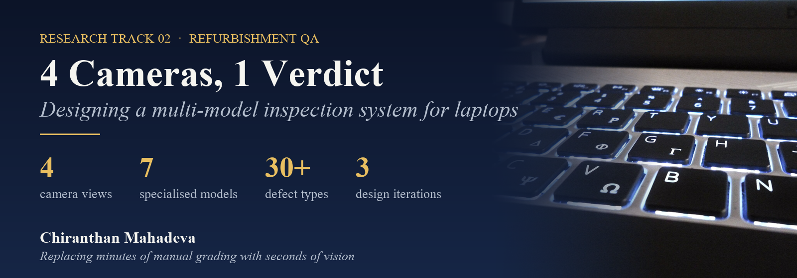
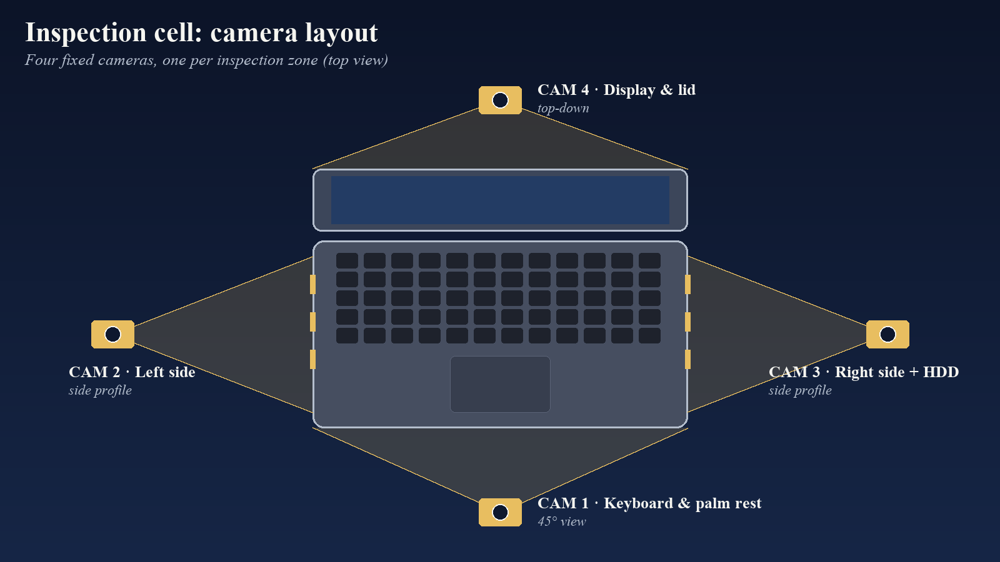
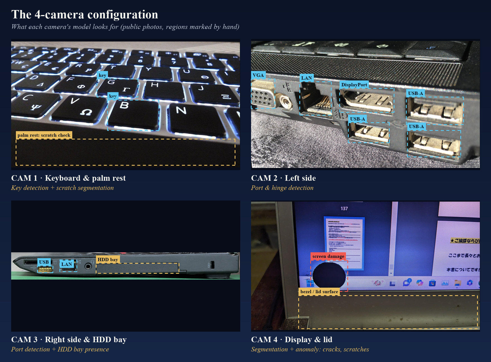
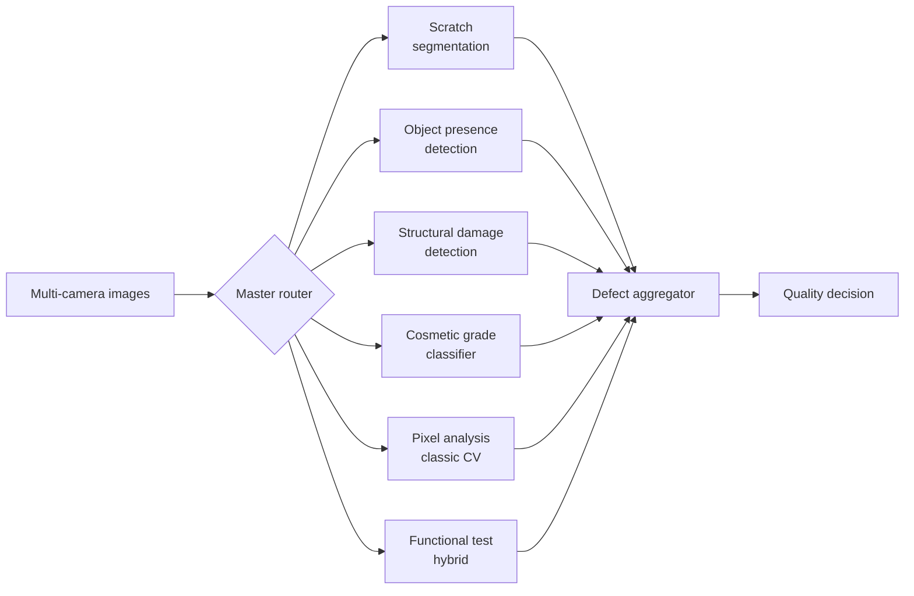
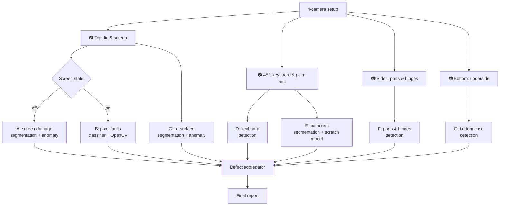

[← All research tracks](../README.md)

## 💻 The problem

Refurbished laptops are graded **by hand**. An inspector checks the screen, lid, keyboard, ports, hinges and underside, and assigns cosmetic and functional defect codes.
For one device this takes **several minutes**, and two inspectors don't always agree.

AI inspection promises speed and consistency, but in refurbishment it runs into two walls:
- **Many different defects on many different surfaces**: scratches on glass, dents in aluminium, missing keys, broken hinges, dead pixels.
- **Little public data**: most defect datasets are generic or recorded in a lab, not taken from real used devices.

**Research question:** how should a camera-and-model system be designed so it can grade a laptop end to end, and which model fits which defect?

## 🧠 The key insight: one model can't see everything

A scratch on a screen, a missing key and a stuck pixel are **different vision problems**:

| Defect family | Examples | Best tool |
|---|---|---|
| Missing or broken parts | Missing keys, port covers, HDD caddy; broken ports | **Object detection**: is the object there or not? |
| Surface damage | Scratches, blemishes, peeling paint, dents, cracked glass | **Segmentation + anomaly detection / lightweight scratch model**: pixel-level, shape-aware |
| Display faults (screen on) | Dead pixels, pixel lines, white spots, low brightness, RGB imbalance | **Classic CV + classifier hybrid** on test patterns |
| Mechanical | Loose or broken hinges, loose keyboard | Detection from the side view |

So the system became a set of **specialised models** behind one **defect aggregator**.

## 📷 The 4-camera configuration

Each camera covers one zone, and each zone has its own model:

Illustration on public photos (credits in <a href="../CREDITS.md">CREDITS.md</a>). The dashed regions were marked by hand to show what each model looks for. They are not model predictions.

## 🔁 Three design iterations

**v1: defect-type routing.** A master router sends each image to a specialised model (scratch, object presence, structural damage, cosmetic grading, pixel analysis, functional test).

**v2: camera-centric with 7 models.** Organised by **what each camera sees**, plus a **screen-state check**: screen off shows physical damage, screen on shows pixel faults.

**v3: final pipeline.** Four fixed cameras: keyboard and palm rest, left side, right side with HDD bay, and display with lid. The bottom view is dropped because the HDD bay is checked from the side. One scratch-segmentation approach is reused for both the keyboard area and the lid.

## 🛠️ What I worked on

- **System architecture**: the three iterations above, from defect-type routing to a camera-centric design.
- **Dataset design for 7 models**: a folder and label structure for each model, covering **30+ defect categories** plus "good" references, with the right label type for each task (boxes, masks or class labels).
- **Training plan, easiest first**: keyboard → bottom → sides → palm rest → lid → screen off → screen on. Simple detection models prove the data pipeline before the hard segmentation and pixel-fault models.
- **Camera layout**: from top-down, 45° keyboard, side profile and bottom views (v2) to the four-camera set-up of v3.
- **Data sourcing**: evaluated public datasets (a CC BY 4.0 laptop-ports dataset, a surface-scratch dataset) to bootstrap training before in-house data.
- **Labeling tooling**: a lightweight OpenCV labeling prototype (paused).
- **State of the art and gap analysis**: manual inspection vs. AI inspection, and the lack of industry-specific datasets.

## 💡 Lessons learned

1. **Design around the camera, not the defect list**: every model sees exactly one view, so training data and failures stay local.
2. **Screen on and screen off are two different inspections**: physical damage and pixel faults need different images and different models.
3. **Start with the easy models**: early wins validate cameras, lighting and labeling before the hardest problems.
4. **Data is the bottleneck**: public datasets help bootstrap, but real refurbished devices are needed for production quality.

## 📚 Papers & resources

| | Reference |
|---|---|
| 📄 | H.-F. Dai, J.-R. Wang, Q. Zhong, D. Qin, H. Liu, F. Guo, **"LCFC-Laptop: A Benchmark Dataset for Detecting Surface Defects in Consumer Electronics"**, *Sensors* 25(15), 4535, 2025. [doi:10.3390/s25154535](https://doi.org/10.3390/s25154535) |
| 🗂️ | **Laptop Ports** dataset (HDMI, USB-A, USB-C), Roboflow Universe, CC BY 4.0. [universe.roboflow.com/yl-qvm05/laptop-ports](https://universe.roboflow.com/yl-qvm05/laptop-ports/dataset/2) |

---

[← Seeing the Seam](../01_WeldSeamInspection/README.md) · [All research tracks](../README.md) · Next: [Teaching Vision to Talk →](../03_VisionAgent/README.md)
