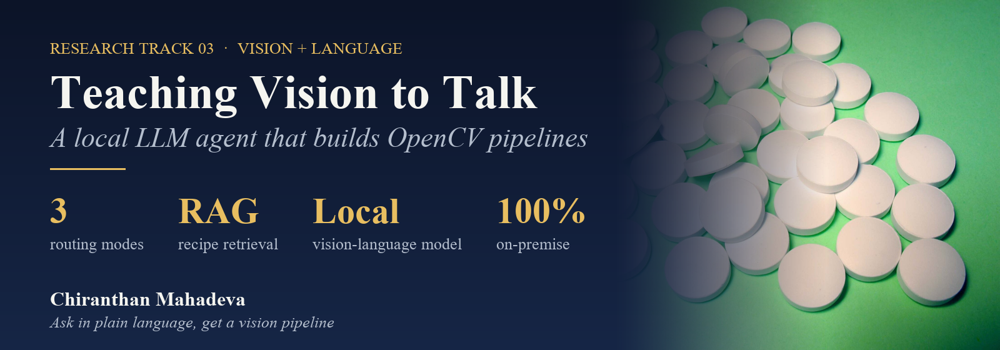
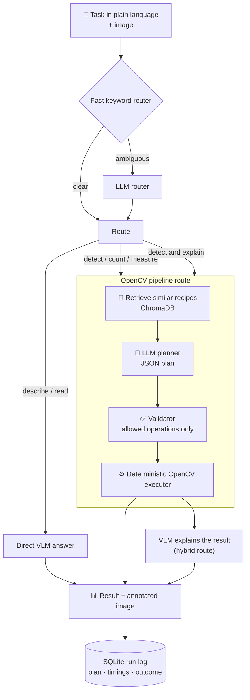
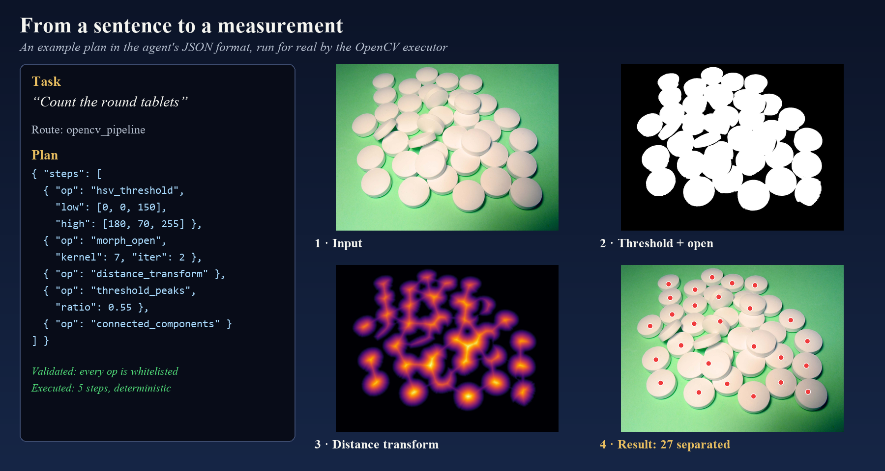

[← All research tracks](../README.md)

## 🗣️ The problem

Building a machine-vision inspection still needs an expert: pick the right filters, thresholds, edge or blob detectors, chain them correctly, and tune everything.
Meanwhile, **vision-language models (VLMs)** can look at an image and describe it in plain language, but they **hallucinate** and can't measure reliably.

**Research question:** can a **local** LLM agent turn a plain-language request ("count the round tablets", "find the edges of the part") into a **real, deterministic OpenCV pipeline**, and explain the result?

## 🧠 The idea: let the LLM plan, let OpenCV measure

The language model never touches the pixels directly for measurement. It **plans**. Proven OpenCV code **executes**. Retrieved examples keep the plan grounded.

### In action: the executor stage

An example plan in the agent's JSON format, executed for real with OpenCV on a public photo.
The pipeline finds **27 separate tablets**. Stacked and touching tablets merge into one blob, so the real number is higher.
That's exactly why the **hybrid route** exists: the numbers come from deterministic code, and the VLM is asked to explain the result and flag what the pipeline can't separate.

### Building blocks

| Component | Role |
|---|---|
| **Fast keyword router** | Routes obvious tasks (edges, circles, count, OCR, describe) without an LLM call, which saves seconds per request |
| **LLM router** | Decides between *direct answer*, *OpenCV pipeline* or *hybrid* when the keywords are ambiguous |
| **Recipe retrieval (RAG)** | A **ChromaDB** vector store of curated OpenCV example pipelines. The most similar recipes are passed to the planner. |
| **LLM planner** | Writes the pipeline as **structured JSON**, using only operations that appear in the retrieved recipes |
| **Validator** | Rejects any step outside the whitelist, so no invented functions and no arbitrary code |
| **Executor** | Runs the plan with OpenCV: thresholding, morphology, Canny edges, Hough lines and circles, contours, connected components |
| **VLM explanation** | In hybrid mode, a VLM looks at the original image and the measured result and explains them |
| **Run log** | Every run is stored in SQLite with the plan, the retrieved examples, timings and the result, for evaluation and reuse |
| **Knowledge-base builder** | A small GUI for adding new example recipes to SQLite and ChromaDB |

## 🔬 How the research progressed

| Step | Experiment | What I learned |
|---|---|---|
| 1 | Text chatbot on a local LLM (Ollama) | Local inference is feasible; prompt structure matters |
| 2 | **Visionbot**: multi-image chat with a **13B open vision-language model** | VLMs describe images well, but give numbers they can't back up |
| 3 | **Agent beta**: router + RAG + JSON planner + OpenCV executor, **7B vision-language model** | Grounding the plan in retrieved recipes turns the answers into reproducible pipelines |
| 4 | Speed-up: **3B vision-language model**, keyword fast path, remote GPU through an SSH tunnel | A smaller model is enough for routing, planning and explaining, so latency drops a lot |
| 5 | Desktop GUI prototype | Running tasks and inspecting plans and results without a terminal makes the agent usable by non-programmers |

## 💡 Lessons learned

1. **The LLM is the planner, not the measuring tool**: numbers must come from deterministic code.
2. **Constrain the output**: JSON plans plus an operation whitelist make an LLM's answer verifiable and repeatable.
3. **Retrieval beats prompting**: a few good example pipelines guide the planner better than long instructions.
4. **Don't call the LLM when you don't need to**: a keyword fast path handles most simple tasks instantly.
5. **Keep it on-premise**: industrial images often can't leave the plant, and local models via Ollama make that possible.
6. **Log everything**: stored runs become the evaluation set and new recipes for the knowledge base.

## 📚 Papers & resources

| | Reference |
|---|---|
| 📄 | A. Vaswani et al., **"Attention Is All You Need"**, NeurIPS 2017. [arXiv:1706.03762](https://arxiv.org/abs/1706.03762) |
| 📄 | A. Dosovitskiy et al., **"An Image is Worth 16x16 Words: Transformers for Image Recognition at Scale"** (ViT), ICLR 2021. [arXiv:2010.11929](https://arxiv.org/abs/2010.11929) |
| 📄 | A. Radford et al., **"Learning Transferable Visual Models From Natural Language Supervision"** (CLIP), ICML 2021. [arXiv:2103.00020](https://arxiv.org/abs/2103.00020) |
| 📄 | R. Eldan, Y. Li, **"TinyStories: How Small Can Language Models Be and Still Speak Coherent English?"**, 2023. [arXiv:2305.07759](https://arxiv.org/abs/2305.07759) |
| 📄 | A. Cho et al., **"Transformer Explainer: Interactive Learning of Text-Generative Models"**, 2024. [arXiv:2408.04619](https://arxiv.org/abs/2408.04619) |
| 📄 | P. Lewis et al., **"Retrieval-Augmented Generation for Knowledge-Intensive NLP Tasks"**, NeurIPS 2020. [arXiv:2005.11401](https://arxiv.org/abs/2005.11401) |
| 🛠️ | [Ollama](https://ollama.com) (local LLM runtime) · [ChromaDB](https://www.trychroma.com) (vector store) · [OpenCV](https://opencv.org) |

---

[← 4 Cameras, 1 Verdict](../02_LaptopInspection/README.md) · [All research tracks](../README.md)
