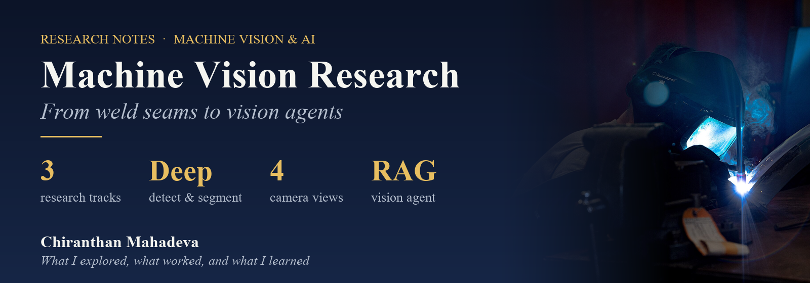

  

  
  
  
  

  <b>Research notes from industrial machine vision: the problem, the idea, what I built, 
  what the results showed, and the papers behind it.</b>

---

## 🔬 Research tracks

### 01 · [🔥 Seeing the Seam](01_WeldSeamInspection/README.md)
**A staged deep-learning pipeline for weld inspection.**
A detection model finds each weld, a segmentation model outlines it, and a classifier judges it. Includes ROI-guided inference on full production frames and three training iterations reaching **mAP@50 = 0.75**.
`Object detection` `Segmentation` `OpenCV` `Google Colab`

### 02 · [💻 4 Cameras, 1 Verdict](02_LaptopInspection/README.md)
**Designing a multi-model inspection system for refurbished laptops.**
Four camera views, seven specialised models and 30+ defect types: from scratched glass to dead pixels and broken hinges. Three architecture iterations and the reasoning behind each.
`Object detection` `Instance segmentation` `Anomaly detection` `Classic CV`

### 03 · [🗣️ Teaching Vision to Talk](03_VisionAgent/README.md)
**A local LLM agent that builds OpenCV pipelines from plain language.**
Router → recipe retrieval (RAG) → JSON planner → validator → deterministic OpenCV executor, fully on-premise with a local vision-language model.
`LLM agents` `VLM` `RAG` `ChromaDB` `OpenCV`

---

## 🧭 How each note is structured

| Section | |
|---|---|
| **The problem** | Why it matters in a real factory |
| **The idea** | The core design, with a diagram |
| **What I built** | Experiments, models and results |
| **Lessons learned** | What worked, what didn't, and why |
| **Papers & resources** | The research behind it, with links |

## 📌 Note

This work was done in an industrial setting. To respect customer confidentiality, the notes describe **concepts, architectures and results**:
no production code, customer names, customer images or proprietary data. Papers are linked rather than redistributed.

## 🖼️ Images

All photos are freely licensed images from Wikimedia Commons, see [CREDITS.md](CREDITS.md). No customer images are used.

## 👤 About

**Chiranthan Mahadeva**, M.Sc. Computer Science (Ulm University), working on industrial machine vision and AI.

More projects: [VirtualReality-HapticGlove](https://github.com/Gojoinferno/VirtualReality-HapticGlove) · [STM32-SecureEEPROM](https://github.com/Gojoinferno/STM32-SecureEEPROM)
